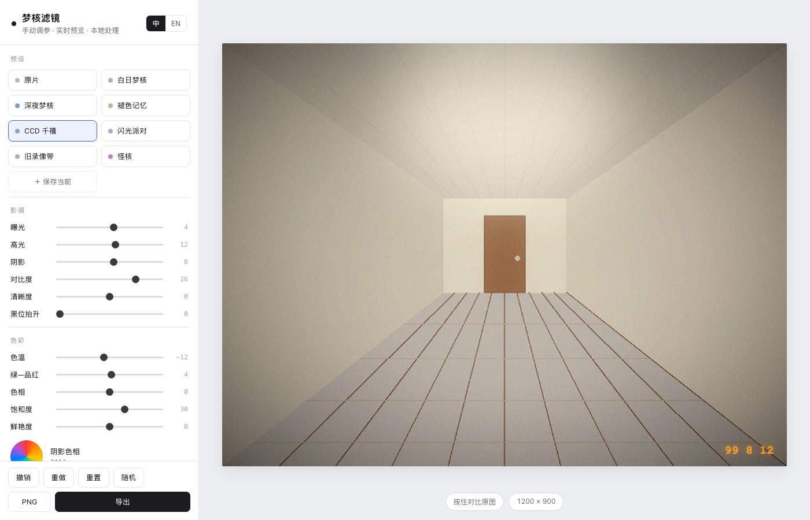
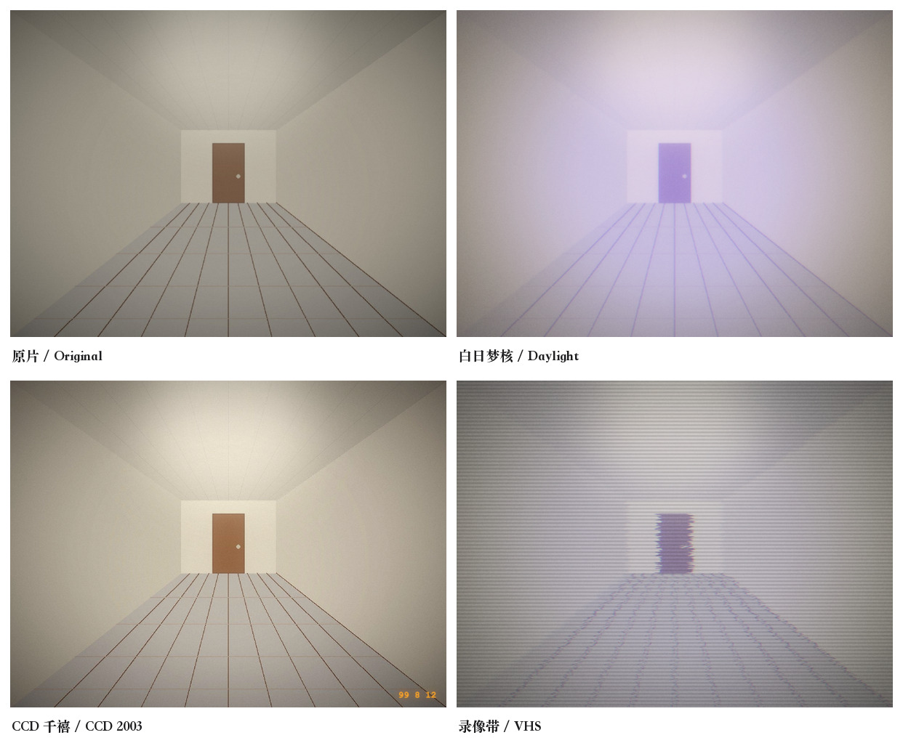

# 梦核滤镜 · Dreamcore Filter

在浏览器里把照片调成梦核 / 千禧年数码相机风格。单文件、零依赖、不联网，图片不会离开你的电脑。

一个 HTML 文件，双击就能用。没有构建步骤，没有服务器，没有账号。



## 效果



左上原片，其余三张分别是白日梦核、CCD 千禧、录像带预设。测试图取材于 `samples/`。

## 特性

- **30 个可调参数**，覆盖影调、色彩、质感、叠加四组，不是套一层 LUT 那么简单
- **8 组预设**：从空旷白天的洗紫褪色，到 2003 年 CCD 直出的冷调 + 日期戳
- **实时预览**：拖动时按 720px 渲染，松手 240ms 后自动重绘 1700px 全质量
- **纯本地处理**：图片通过 `objectURL` 读入，不上传、不经过任何服务端
- **中英双语**：右上角切换，记住偏好
- **自定义预设**：调好的参数可以命名保存，存在 localStorage
- **撤销 / 重做**：最多 80 步
- **导出**：PNG / JPEG，最长边最高 3200px

## 开始使用

下载 `index.html`，双击打开。把图片拖进右侧区域，或点击选择，或直接 `⌘V` 粘贴。

不需要装任何东西。想放到自己的网站上，把这个文件扔进静态目录即可。

## 预设

| 预设 | 对应什么 |
|---|---|
| 原片 | 不处理，用于对比 |
| 白日梦核 | 空旷白天的场景：过曝、褪色、阴影染池蓝、高光染褪色粉、柔光雾化 |
| 深夜梦核 | 泳池、走廊、夜间室内：明显偏冷、深蓝紫阴影、病态黄绿高光、重暗角 |
| 褪色记忆 | 暖黄旧照片但略不对味：重褪色、黄绿阴影、暖色光晕、重柔化 |
| CCD 千禧 | 2003 年入门数码相机直出：冷调白平衡、高对比、紫边、硬锐化、日期戳 |
| 闪光派对 | 闪光灯直打：中心过曝泛光、背景压低、暖橙光晕 |
| 录像带 | VHS：扫描线、逐行抖动、重色差、褪色 |
| 怪核 | Weirdcore：整体色相偏移制造“哪里不对”、过饱和、洋红高光 |

预设只是起点，点开之后每个参数都能继续调。

## 参数

**影调**
`曝光` `高光` `阴影` `对比度` `清晰度` `黑位抬升`

**色彩**
`色温` `绿—品红` `色相` `饱和度` `鲜艳度` `阴影色相` `阴影强度` `高光色相` `高光强度` `肤色保护`

阴影色相和高光色相各有一个色轮，点或拖选色。这两项是分离色调的核心——真实配方里阴影染冷蓝、高光染暖色，而不是互补色。

**质感**
`高光溢出` `暖色光晕` `颗粒` `色差` `柔化` `锐化` `抖动` `暗角` `抗色阶抖动`

**叠加**
`扫描线` `日期水印` `水印位置` `水印文字`

## 快捷键

| 键 | 作用 |
|---|---|
| `⌘Z` / `Ctrl+Z` | 撤销 |
| `⌘⇧Z` / `Ctrl+Shift+Z` | 重做 |
| 按住“对比原图” | 临时显示原片 |
| `⌘V` | 粘贴剪贴板里的图片 |

## 实现说明

处理全部在 Canvas 2D 上完成，管线按顺序是：

```
逐像素色调映射（曝光/高光/阴影/对比/色相/分离色调/饱和度/鲜艳度/暗角/抖动）
  → 柔化（缩放重采样）
  → 清晰度（中频反锐化）
  → 锐化（拉普拉斯）
  → 抖动（逐行水平偏移）
  → 溢光 + 暖色光晕（双向缩放模糊 + screen 混合）
  → 颗粒（噪声 pattern + overlay）
  → 扫描线
  → 日期水印
```

几个值得说明的点：

- **合成层数尽量少**。暗角被并进了主像素循环，而不是最后叠一层径向渐变——因为渐变那层没有抖动保护，8-bit 量化会在暗部留下色带。
- **高光和阴影用幂函数加权**（亮度三次 / 四次方），只作用在真正的亮部和暗部，中间调不动。
- **肤色保护不用模型**。按 HSL 判断色相落在 12°–45°、饱和度 0.10–0.62 的像素，把分离色调对它们的权重降到 32%。够用且零依赖。
- **溢光不用 `ctx.filter = 'blur()'`**。改成两次缩放（1/5 × 1/5）再放大，兼容性更好，也避开了某些渲染路径下的分块伪影。
- **色差**是逐像素读 RGB 三个通道的不同位置，不是叠一张贴图。
- **渲染分档**：拖动 720px，松手 1700px，导出 3200px。三者用同一套参数，结果一致。

单文件约 48 KB，无外部请求。

## 样例图

`samples/` 下有三张程序生成的测试场景（空走廊、房间逆光、水面），用来对比不同预设。它们不是照片，胜在干净、没有版权问题，适合当测试素材。

## 兼容性

Chrome / Edge / Safari 16+ / Firefox 最近版本。需要 Canvas 2D 与 `conic-gradient`。移动端可用，参数面板会堆到下方。

## 贡献

欢迎开 issue 提参数手感的问题（“这个预设蓝得不够”“颗粒太细”这类反馈比功能请求有用得多）。改代码直接改 `index.html`，里面按 文案 / 参数定义 / UI 渲染 / 图像处理 / 事件 分段。

## License

MIT
